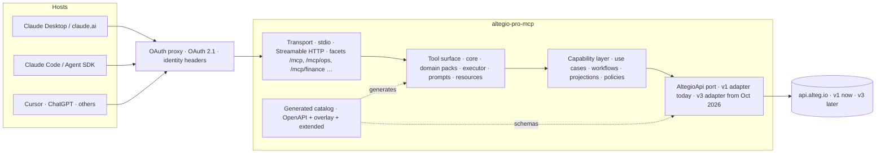

# ADR-001 — Altegio Pro MCP over the full Altegio API

- **Status:** Proposed — needs ratification by the product owner and the API platform team (open decisions in §8).
- **Date:** 2026-09-07
- **Scope:** how one MCP product covers an API of ~1,200 routes (documented and undocumented), how it survives the V1 → V3 migration, and how it stays usable inside the context-window and tool-count limits of today's MCP hosts.

## 1. Context — measured, not assumed

### 1.1 Size of the API surface (2026-09-07)

Numbers come from `scripts/api-inventory/` run against the Altegio API OpenAPI repository (`ALTEGIO_API_DOCS`, master) and from a one-off, black-box inventory of the routes the product's web client calls (deduplicated by method + path; the raw list is internal and stays out of this repository).

| Surface                                    |         Routes / operations | Notes                                                                                                                    |
| ------------------------------------------ | --------------------------: | ------------------------------------------------------------------------------------------------------------------------ |
| Backend `/api/v1` routes                   |                   **1,176** | routes observed from the web client, all route groups                                                                    |
| Documented v1 + public + developers        |                     **304** | v1 260 · public 24 · developers 20 (16 marked deprecated)                                                                |
| Backend v1 routes matched by docs          |                         253 | exact method + normalized-path match                                                                                     |
| Backend v1 routes **not documented**       |                     **923** | the large majority in the main (non-legacy) route group                                                                  |
| Documented ops with no exact backend match |                          51 | aliases (`{location_id}` vs `{salonId}`) or stale entries; needs review                                                  |
| Backend `/api/v2` routes                   |                          54 | JSON:API, **internal ERP-web only** by API-team policy; 42 documented                                                    |
| `/api/v3` (preview contract)               | 57 ops · 37 paths · 12 tags | all `x-altegio-status: preview`; first production release planned **October 2026** (API team flags the date as red risk) |

Where the undocumented v1 routes live (first path segments, top groups):

| Group                                                                             | Undocumented routes | Reading                                                          |
| --------------------------------------------------------------------------------- | ------------------: | ---------------------------------------------------------------- |
| `company/{id}/…`                                                                  |                 365 | location-scoped business features: the main gap for this product |
| `chain/{id}/…`                                                                    |                  47 | chain-level operations                                           |
| `booking/…` (locations, user, chains, search, forms, payments)                    |                  46 | public booking widget internals — out of scope (B2C)             |
| `marketplace/…`                                                                   |                  43 | developer / application management — different persona           |
| `medicine/{id}/…`                                                                 |                  22 | vertical module                                                  |
| first-party administration and internal tooling groups                            |                 ~60 | internal admin, never exposed                                    |
| `tips`, `group`, `integration_wizard`, `client_app`, `segments`, `promo_codes`, … |                rest | mixed; triage per domain                                         |

Conclusion: roughly a third of the undocumented surface is relevant to business owners and administrators (the `company/{id}` and `chain/{id}` groups plus a few utilities); the rest is internal or belongs to other personas. **Undocumented means no contract**: those routes serve the ERP web client and can change without notice.

### 1.2 What the API team has already decided (the V3 API standardization plan)

- **V3 is the only new public contract.** Flat REST under `/api/v3/locations/{location_id}/…`, `problem+json` errors with stable `code`, cursor pagination, `Idempotency-Key`, `If-Match`, OpenAPI 3.1 as the contract with a CI gate in both repos (`x-altegio-status: available` requires a registered route).
- **V2 stays internal**, V1 is legacy: no new public methods are added to V1.
  _Update 2026-09-29: the product owner decided that V2 is the canonical live
  contract and V1 is only a fallback where V2 lacks a capability. The catalog
  reads the V2 spec and retires every V1 operation that V2 replaces (see
  [the catalog](catalog.md#v2-supersedes-v1)). Curated tools, starting with
  the `events_*` pack, call V2 first. Clients see one operation per capability,
  in the product glossary, and never an API version. V3 remains the target
  contract._
- **Auth is OAuth 2.1**: Authorization Code + PKCE for agents and MCP hosts (DCR and Client ID Metadata Documents accepted), Client Credentials for marketplace backends, restricted keys for a business's own scripts. **There is no password grant in V3.** Token audiences are split: `https://api.alteg.io/api/v3` for REST and a separate MCP audience for a hosted MCP; a REST token is not accepted by MCP and vice versa.
- **The first audience of V3 is external partners and MCP/AI integrations.** The team also plans the backend use-case layer so that "REST v3 controller, MCP tool handler and legacy v2 adapter call one shared service" (guardrails §9) — a future in-process MCP inside the monolith is on their table.

### 1.3 The MCP host landscape this product must fit (September 2026, updated 2026-10-20)

| Host / mechanism                                                       | Fact                                                                                                                                                                                                                                                                                                                                                                                                                                                                       | Consequence for us                                                                                                                                                                        |
| ---------------------------------------------------------------------- | -------------------------------------------------------------------------------------------------------------------------------------------------------------------------------------------------------------------------------------------------------------------------------------------------------------------------------------------------------------------------------------------------------------------------------------------------------------------------- | ----------------------------------------------------------------------------------------------------------------------------------------------------------------------------------------- |
| MCP spec **2026-07-28** (final)                                        | Stateless core, no `Mcp-Session-Id`; `tools/list` must not vary per connection and should be deterministic; `ttlMs` / `cacheScope` on list results; Tasks and MCP Apps are extensions; MRTR replaces server-initiated elicitation; `Mcp-Method` / `Mcp-Name` headers allow gateway routing by tool name. Roots, Sampling and Logging deprecated.                                                                                                                           | No per-session tool toggling. Static tool lists. Cross-call state travels as server-minted handles in tool arguments. Sharding by tool name is a deployment detail, invisible to clients. |
| TypeScript SDK                                                         | `1.30.0` = protocol 2025-11-25 (we are on 1.29). `2.0.0` is a **beta** with dual-era `createMcpHandler`; 1.x servers keep working for 2.x clients indefinitely. Platform plan: canary SDK v2 on one low-risk server first.                                                                                                                                                                                                                                                 | Stay on 1.x now, design for the 2026-07-28 constraints, migrate after the platform canary.                                                                                                |
| Claude API tool search (`defer_loading`, `mcp_toolset.default_config`) | Up to 10,000 deferred tools; search matches names, descriptions, argument names and descriptions; keep the 3–5 hottest tools non-deferred; Anthropic's own guidance: selection accuracy degrades past 30–50 loaded tools.                                                                                                                                                                                                                                                  | A large catalog is viable **if** names carry consistent prefixes and descriptions carry the user's vocabulary.                                                                            |
| Claude Code / Agent SDK                                                | Tool search on by default (`ENABLE_TOOL_SEARCH`, `auto` threshold 10 % of context). _Updated 2026-10-20:_ tools from HTTP connectors are now deferred too — a Claude Code session lists this server's connector tools as deferred, which retires the September reading of issue #40314. Anthropic measured tool search cutting a 50+ tool set from ~77k to ~8.7k tokens and raising MCP-eval accuracy from 49 % to 74 % (Opus 4) and from 79.5 % to 88.1 % (Opus 4.5) [1]. | Claude hosts no longer pay the whole default view up front. Keep names prefixed and descriptions in the user's vocabulary, because search reads them.                                     |
| claude.ai connectors                                                   | Connector tools are deferred behind tool search, as in Claude Code (observed 2026-10-20).                                                                                                                                                                                                                                                                                                                                                                                  | Same as above.                                                                                                                                                                            |
| Cursor                                                                 | _Updated 2026-10-20:_ "dynamic context discovery" (2026-01-06) syncs MCP tool descriptions to files the agent reads on demand and reports −46.9 % agent tokens [2]. The 40-active-tool cap is reported gone from 2.3 on, but only on the forum, not in the docs [3].                                                                                                                                                                                                       | The 40-tool rule no longer has a host behind it. D3 now budgets bytes instead (D3 amendment).                                                                                             |
| ChatGPT (`openai-mcp`, developer mode and workspace apps)              | No documented tool cap. It loads and caches the full `tools/list`; our logs show one MCP session per tool call.                                                                                                                                                                                                                                                                                                                                                            | Pays the whole view per session. This is the host the byte budget protects.                                                                                                               |
| GitHub remote MCP                                                      | A small default toolset at `/`, one path per toolset (`/x/{toolset}`), `/readonly`, and `X-MCP-Toolsets` / `X-MCP-Readonly` headers. Dynamic toolsets are beta and off by default [4][5].                                                                                                                                                                                                                                                                                  | The same shape as our facets and read-only view: static views on sub-paths.                                                                                                               |
| Atlassian Rovo MCP                                                     | 21 "primary" tools in `tools/list`. The rest of the catalog sits behind `discover` plus `executeRead` / `executeWrite` / `executeDestructive` (one per risk tier, with agent-level confirmation) and 30 permission groups; docs updated 2026-09-30 [6].                                                                                                                                                                                                                    | A server-side discover/execute over curated tools shrinks a view without making a tool unreachable. A candidate for `/mcp`, gated on evals.                                               |

Sources for the 2026-10-20 update:

1. Anthropic, "Introducing advanced tool use" (2025-11-24): https://www.anthropic.com/engineering/advanced-tool-use
2. Cursor, "Dynamic context discovery" (2026-01-06): https://cursor.com/blog/dynamic-context-discovery
3. Cursor forum, on the MCP tool limit: https://forum.cursor.com/t/regarding-the-quantity-limit-of-mcp-tools/153432
4. GitHub MCP remote server (toolset paths, read-only, headers): https://github.com/github/github-mcp-server/blob/main/docs/remote-server.md
5. GitHub MCP default toolsets discussion: https://github.com/github/github-mcp-server/discussions/1182
6. Atlassian Rovo MCP supported tools (discover/execute, permission groups): https://developer.atlassian.com/cloud/rovo-mcp/guides/supported-tools/

### 1.4 Where the current server stands

42 tools, all on V1, defined through `defineTool` (Zod → JSON Schema, annotations, `outputSchema`, structured output), an onboarding wizard with file-backed state, request-scoped delegated identity behind the platform's OAuth proxy (`x-mcp-auth-*` headers), stdio + Streamable HTTP, protocol 2025-11-25, spec-compliance tests mapping tools to OpenAPI operations (`src/tools/api-mapping.ts`). No MCP prompts or resources are registered although the capability is declared. Tool names already use the V3 glossary (location, team member, appointment).

## 2. Decision in one paragraph

Build **one product, one server, one endpoint and one OAuth audience**, not a family of thematic MCP servers. Inside it, organise the API as a **catalog** (OpenAPI + curated overlay) that generates domain tool packs, keep a small always-loaded **core** of task-shaped tools, add a **universal executor** for the long tail, and publish **facets** — static, filtered views of the same catalog on sub-paths — for hosts that cannot defer tools. Tool contracts speak the V3 glossary from day one; V1 is an adapter behind a port, so the October V3 release replaces adapters, not tools. Undocumented endpoints enter the product only through an explicit allowlist with contract tests, and the inventory that finds them feeds the spec repository, not the MCP directly.

## 3. Decisions

### D1 — One server, one audience (not N thematic servers)

Thematic servers look attractive for context economy, but every argument for them is solved today by tool search, static facets, and header-based routing, while their costs stay:

- Business workflows cross domains constantly (booking = availability + client + team member + service + payment). Splitting servers pushes composition onto the model.
- Each server is a separate OAuth audience at the platform's OAuth proxy, a separate consent, a separate credential store, a separate deploy, a separate eval suite.
- Prompt caching favours one stable tool prefix per session over several servers loaded and unloaded.
- The 2026-07-28 spec lets a gateway route by `Mcp-Name`; if we ever need to shard processes by domain, we can do it behind the endpoint without touching clients.

Separate servers are reserved for **different personas or audiences**: public booking (B2C, end clients), marketplace developers (`developers` API). Neither is in scope of Altegio Pro.

### D2 — Three-tier tool surface

| Tier                   | What                                                                                                                                                                                                                                                                                                                        | Size               | Loading                                                                                                  |
| ---------------------- | --------------------------------------------------------------------------------------------------------------------------------------------------------------------------------------------------------------------------------------------------------------------------------------------------------------------------- | ------------------ | -------------------------------------------------------------------------------------------------------- |
| **Core**               | Task-shaped tools that answer the daily questions of an owner or administrator: today's journal, find availability, book / reschedule / cancel, client lookup and client card, staff schedule, service catalog basics, sales summary, onboarding entry points, auth, `locations_list`, plus the three executor tools below. | ≤ 24               | Always loaded; the only tools most sessions ever need.                                                   |
| **Domain packs**       | CRUD and reporting tools generated from the catalog per domain: `staff_*`, `services_*`, `clients_*`, `appointments_*`, `visits_*`, `payments_*`, `schedule_*`, `settings_*`, `analytics_*`, `loyalty_*`, `inventory_*`, `salary_*`, `notifications_*`, `chain_*`. Curated descriptions, projections, annotations.          | hundreds over time | Deferred where the host supports tool search; otherwise exposed through facets (D3).                     |
| **Universal executor** | `api_search_operations` (query → operations with one-line summaries), `api_describe_operation` (full input/output schema, examples, permissions), `api_call_operation` (validated call). Backed by the same catalog.                                                                                                        | 3                  | Always loaded. Covers every documented operation the day the spec changes, before anyone curates a tool. |

Executor policy: any **documented read** is callable; **writes** only for operations on an allowlist (curated packs cover the common ones); **undocumented** operations only when they carry an extended-catalog entry with a golden contract test (D4). Results pass through the same projection and size budget as curated tools.

### D3 — Facets: static views on sub-paths

`/mcp` (default) serves core + the most used packs within a **byte budget** on its `tools/list` (amended 2026-10-20; it said "under 40 tools" before). `/mcp/<facet>` serves a fixed subset per facet: `ops` (journal, appointments, clients), `catalog` (services, staff, schedule, settings), `finance` (visits, payments, analytics, salary), `marketing` (loyalty, notifications, chain), `onboarding`. Facet membership is a field in the curation overlay; lists are computed once at startup, deterministic and cacheable — compliant with the 2026-07-28 "no per-connection variance" rule, unlike runtime tool toggling.

The platform proxy forwards everything under `/pro/*` to the service, so facets need no new routes, audiences or scopes. Facets are a compatibility shim for hosts without tool search; they are not product boundaries and share one credential.

**Amendment (2026-10-20) — a byte budget replaces the 40-tool rule.** The 40-tool rule came from Cursor's cap, which is reported gone (§1.3). It had also not been true for months: `/mcp` served 115 tools and 139 KB. And it counted the wrong thing, because tools differ tenfold in cost: `clients_search` lists at about 5 KB, the median tool at about 0.9 KB and the smallest at 0.3 KB. What a host that loads the whole list pays is bytes, so the rule is on bytes:

- every HTTP view has a budget on its serialized `tools/list` result in `src/tools/listing-budget.ts`: the measured size plus about 5 % headroom. The size is measured from the same module the registry answers `tools/list` with, and a test checks that against a real connection;
- `npm test` and `npm run surface:check` fail when a view is over budget, and the generated `docs/architecture/tool-surface.md` prints every view's size and share of its budget, so each surface change shows its cost in the diff;
- raising a budget is a reviewed decision in that file, never a side effect of a new tool. A demotion or a trimmed schema lowers the budget in the same change;
- `/mcp` is headed for **100,000 bytes or less** (about 25k tokens). It gets there by moving rarely used packs to their facet, decided from 30 days of `tool_call` counts, and by trimming the heaviest schemas. The product owner decides each demotion; the budget does not move tools.

On the same date, back-office finance (`financial_transactions_*`, `payroll_*`) joined `/mcp`. Owners are the default view's first audience (D2). Withholding expenses and payroll while serving payments and stock writes left an owner with no way to record an expense from the default address. `/mcp` measured 148,042 bytes and 121 tools after that change, with a budget of 155,500. `/mcp/finance` and `/mcp/readonly` did not change.

**Step 1 (2026-10-20) — six low-use groups demoted.** The longest window with per-tool counts is 22 days of proxy `/pro` calls (the proxy has logged the tool name only since 2026-09-28; the server's `tool_call` since 2026-10-05). In it, 26 tools carried 442 of about 164,600 calls (0.27 %) and 23 KB of the listing: the onboarding wizard, event duplication patterns, client files, membership freeze/balance/validity changes, membership type archive/delete, and booking form create/delete. They are listed in `DEFAULT_FACET_DEMOTED_GROUPS` and served on their facet only; the read-only view and the facets do not change. A model on `/mcp` still learns where they are: the default view's `initialize` instructions name each group and its address, neighbouring descriptions name the tools and get the automatic "served on" clause, and a call is refused with the address that serves the tool. The `MCP_DEFAULT_FACET_EXCLUDE_ONBOARDING` switch is gone, since the wizard is now off `/mcp` in every deployment. `/mcp` measured 125,389 bytes and 95 tools after this step, with a budget of 132,000.

**Addendum (2026-09-17) — `/mcp/readonly` is a view, not a facet.** A facet answers _how many tools fit in this host's context_; the read-only address answers _what may this agent do at all_. Same sub-path mechanism, different question and different membership rule: a facet is a hand-curated domain slice in the overlay, the read-only view is computed from each tool's own `readOnlyHint`. It therefore lives alongside `default` and `all` rather than inside `FACET_NAMES`, and is not offered as an alternative destination when a facet refuses a tool. The restriction is expressed as a separate URL because a separate URL is a separate OAuth resource — the industry pattern (GitHub, Linear, Sentry, Stripe, Notion, Atlassian, Slack) and the only form both the protocol and current hosts respect; a caller-set header (`X-MCP-Readonly`) would enforce nothing and would vary `tools/list` on one resource, which D7 forbids. Whether it is a guardrail or a boundary depends on the token, not on the address: with a full grant it constrains only what this server offers (the credential can still write, including outside MCP), so its purpose is to let the consent screen stay all-or-nothing (D6).

**Correction (2026-09-17).** The sentence above originally said the boundary had to wait for V3. It does not. The platform proxy already issues `mcp:pro:read` / `mcp:pro:write` per route and forwards the granted subset as `x-mcp-auth-scope` on every identity-forwarding route — which the first version of the execution gate wrongly assumed no deployment sent. With the two vocabularies reconciled in `src/tools/scopes.ts`, a token issued as `mcp:pro:read` alone refuses every write on **every** address, `/mcp` included, before the handler runs. The read-only address is therefore the _surface_ half of the restriction and the token scope is the _rights_ half; together they are enforceable today, and V3 only replaces the coarse `mcp:pro:*` pair with the fine-grained `domain:action` names.

### D4 — The catalog is the source of truth; generation happens at build time

```
../biz.erp.api.docs (OpenAPI v1 / public / developers / v3)
        │  + catalog/overlay/*.yaml   (names, descriptions, hidden params, projections,
        │                              annotations, domain, tier, facets, write allowlist)
        │  + catalog/extended/*.yaml  (hand-written stubs for allowlisted undocumented
        │                              endpoints, each with a golden contract test)
        ▼
scripts/catalog/build.mjs  ──►  src/generated/{catalog.json, packs/*.ts}   (committed, reviewed in PRs)
```

- Build-time, not runtime: `tools/list` is reviewable in a diff, deterministic, and testable; evals catch description regressions before deploy.
- The existing `api-mapping.ts` + spec-compliance test is the seed: it already maps tools to `operationId`s. The generator inverts it (operation → tool) and the test becomes a drift check: an operation removed or changed in the spec fails CI until the overlay is updated.
- Undocumented routes are **not** read from any private source at build time. The spec inventory (`scripts/api-inventory/`) is a triage tool: it produces the list of missing endpoints for the spec repository (V1 path files or a V3 request), and only endpoints that reach the spec — or an `extended/` stub with a contract test — become tools. The repository is public, so inventories of undocumented routes stay in the gitignored `.inventory/` folder.
- Discovery and temporary adaptation of undocumented web-client sources follows [`legacy-endpoint-discovery.md`](legacy-endpoint-discovery.md): start from an owner decision, observe the route black-box through the product's web client, reject unsafe candidates, and keep every legacy detail behind a canonical tested contract.

**Addendum (2026-09-17) — the surface table: the same reviewability rule, applied to the _views_.** The catalog makes `tools/list` reviewable for one view. It says nothing about the question that actually grew hard: eight mechanisms now decide whether a tool reaches a given address and whether the call it receives runs there — the report-builder closure (`DISABLED_TOOL_NAMES`), the default view's excluded prefixes, excluded names and re-admitted names, the password-login switch, the read-only rule, the token-scope map (D6 addendum) and the human-confirmation gate (D8 addendum). Each is justified on its own terms; collapsing them into one list would destroy the justifications, which is worse than six lists. What was missing was not fewer mechanisms but **one place that joins them**.

`src/tools/surface.ts` produces one cell per tool × per view: served or withheld, a _machine value_ for the reason, and the gates that still refuse the call. It is not a second implementation — membership comes from `decideView` in `src/tools/facets.ts`, the only membership function in the server, and `buildFacetIndex` is a projection of the same function, pinned by a test that compares them under every switch combination. `src/tools/inventory.ts` is the single enumeration of what exists, disabled tools included, because "why is this tool nowhere?" cannot be answered about a tool the inventory has already dropped.

The table renders to the committed `docs/architecture/tool-surface.md` (`npm run surface:build`, checked by `npm run surface:check` and by the test suite), so a surface change reaches a reviewer's diff exactly the way a catalog change does. Tool counts follow the same rule: `README.md` and `CLAUDE.md` quote a computed sentence and per-category counts that a test pins — CLAUDE.md had claimed "69 total" while 72 were defined and 66 served.

### D5 — V3 glossary in contracts, V1 behind a port

Tool names, parameters and result fields use the V3 object model (`location`, `team_member`, `service`, `client`, `appointment`, `visit`, `payment`, `position`, `resource`). The capability layer calls an `AltegioApi` port; `v1` adapters implement it today, `v3` adapters replace them per domain as operations flip to `available`. Tool names never change during the migration, so hosts, prompts and evals keep working. Fields that exist only in V1 are marked `x-v1-only` in the overlay so the drift check reports them when V3 becomes canonical.

### D6 — Auth roadmap

| Today                                                                                                                                                                             | After V3 auth (planned Oct 2026)                                                                                                                                                                                                                                                                                                         |
| --------------------------------------------------------------------------------------------------------------------------------------------------------------------------------- | ---------------------------------------------------------------------------------------------------------------------------------------------------------------------------------------------------------------------------------------------------------------------------------------------------------------------------------------- |
| Google OIDC at `mcp.alteg.io` (staff only, `hd=alteg.io`), identity forwarded as `x-mcp-auth-*`; `auth_login` exchanges email + password for a V1 user token stored per identity. | The MCP server is an **OAuth protected resource** with its own audience at Altegio's authorization server. Hosts obtain an Altegio token (Code + PKCE, DCR/CIMD) and the server forwards it as `Authorization: Bearer` to `api.alteg.io`. No passwords ever pass through the server. `auth_login` is deprecated the day V3 auth is live. |

This is the biggest cross-team dependency: the MCP audience, the protected-resource metadata and the relation to the platform proxy's own authorization server must be agreed with the API team (§8).

**Addendum (2026-09-17) — token scopes are enforced on execution, and only on execution.** The v3 authorization RFC settled that the access boundary is the _scope of the token_: the MCP spec forbids clients from treating annotations as a security decision, and a separate address (D3 addendum) only lets a deployment pick a rights profile — it restricts nothing by itself. The OAuth proxy has forwarded the caller's granted scopes as `x-mcp-auth-scope` since the platform shipped and nothing read them; now every tool declares what its execution requires and the `tools/call` handler checks it.

- **One map file.** `src/tools/scopes.ts` holds the vocabulary, the tool→scope map, the satisfaction rule and the refusal text. No tool definition names a scope — `defineTool` fills `ToolDefinition.requiredScopes` from the map by tool name — so approving a different vocabulary is one edit rather than seventy, and a coverage test fails the build when a tool has no entry.
- **Two vocabularies, one rule, one file.** Requirements are written in the v3 `domain:action` names — their shape follows the ratified convention and most are verbatim from the v3 P0 catalog, which is explicitly not final and is owned by the API team (`analytics:*` and `api:read` had to be invented: no v3 domain covers reports, and the universal executor reaches every documented GET under one tool name). The grants that actually arrive are the platform's coarse `mcp:pro:read` / `mcp:pro:write`, which the proxy issues per route. Both live in `src/tools/scopes.ts` and the reconciliation rule is stated once, in `scopeSatisfied`; the platform pair is deleted the day v3 issues `domain:action` tokens.
- **Execution only, never `tools/list` (D7).** One path serves one tool list to every connection, whatever the caller's grant. A tool a caller cannot run is still listed and explains itself when called. Filtering the list by scope would make `tools/list` vary per connection, which 2026-07-28 forbids, and would also make the surface unreviewable in a diff (D4).
- **Only `X:write ⊇ X:read` is implied** (v3 A8/F-13), on the same domain. `create`, `manage_access`, `capture` and `refund` always need an explicit grant, and `chain_*` never satisfies a location scope. `clients:read_contact` gates _fields_ inside a response, which V1 cannot express; it is deliberately not faked and belongs to the V3 adapter work.
- **Absent and invalid are different states.** Local stdio declares no scopes and
  keeps the compatibility path. Once the trusted proxy sends
  `x-mcp-auth-scope`, an empty, malformed or unknown grant fails closed. The
  public Altegio-token lane validates raw tokens and forwards its route's
  verified `mcp:pro:*` grant even though it has no delegated identity header, so
  both public and closed HTTP routes execute the same scope gate. Vocabulary
  drift is handled as a deployment error rather than wider access.
- **The refusal is in band** — an `isError` result, the same channel as the confirmation gate — never an HTTP 403, which drops the session, and never upstream API text. Hosts do not re-authorise on a mid-session denial (Claude Code closed that as "not planned", April 2026), so the message says not to retry and tells the model to route a named missing permission to a person.
- **Order:** the scope check runs _before_ the confirmation gate, so a call the token cannot authorise never prompts a human and never makes the API read that resolves the prompt's target.

### D7 — Protocol posture

Stay on SDK 1.x / protocol 2025-11-25 in production, but write code that is already legal under 2026-07-28: static tool lists, no session-scoped tool state, cross-call state (onboarding sessions) passed as server-minted handles in tool arguments, long-running imports designed as poll-able jobs (Tasks extension candidates), deterministic `tools/list` ordering. Migrate to SDK v2 (`createMcpHandler`, dual era) after the platform's canary on a low-risk server; remove `StreamableHTTPServerTransport` session bookkeeping then.

### D8 — Context economy rules for every tool

- Structured result = projection of the API object (allowlisted fields), never the raw payload; text = a short summary the model can quote.
- Lists default to 20–30 items, cursor or page continuation, `count` returned; `fields` / `expand` where the API supports them.
- Hard size budget per result (target ≤ 4k tokens) with truncation and a "narrow the query" hint.
- Errors carry the next action ("call `locations_list`", "authenticate", "reduce the date range").

**Addendum (2026-09-17) — destructive operations ask a human first.** `destructiveHint` is a hint the spec forbids clients from treating as a security boundary, and on an autonomous agent with no human in the loop it protects nothing at all. Elicitation is the protocol's own answer: the server asks, regardless of how the host is configured. Eleven tools are gated today (the eight `delete_*`/`unlink_*` tools, `locations_remove_user`, `onboarding_rollback_phase` and the withheld `analytics_delete_assistant_report`).

- **Two paths, chosen from the capabilities the client declared at `initialize`.** With `elicitation`: an `elicitation/create` form naming the _resolved_ object ("team member Ivan Petrov, Stylist, id 123") and the consequence; it runs only on an explicit accept, and a decline, a cancel or a failed prompt stops the call with no token issued. Without it: the first call performs nothing and returns the consequence plus a `confirmation_token`, and the identical call repeated with that token proceeds. Without that fallback the call would simply hang on an older host.
- **Confirmation uses the protocol action (2026-10-01).** A form with an empty object schema collects no additional data: `action: "accept"` approves the named operation, whether `content` is omitted or empty. The former required `decision` enum duplicated the host's confirmation controls and rejected accepted prompts without that extra field. `decline` and `cancel` remain distinct refusals; a dismissed prompt does not claim that a human explicitly declined. URL-only clients take the confirmation-token path, because they cannot display a form.
- **The token is bound to the exact arguments.** HMAC over tool name + arguments, keyed per process, 10-minute TTL, refused rather than ignored when it does not verify — so a confirmation for client 5 never authorises deleting client 7. Nothing is stored server-side, which keeps `tools/list` static and no state session-scoped (D7); `confirmation_token` is an always-present optional argument, never negotiated per client.
- **The token is valid for its arguments until it expires, not once (amended 2026-10-20).** Being stateless, it authorises those exact arguments as often as they are sent within the 10 minutes; a single-use token would need shared server state, which D7 rules out. The token text says so ("valid for these arguments until <time>"). Replay protection is the tool's job, as a precondition on the state the person approved — the V1/V2 stand-in for V3's `If-Match` and `Idempotency-Key`:
  - money and stock writes carry their own replay guard: the amount due or balance the caller read, the current quantity of a visit product line, or an identical record (financial transaction, inventory operation) made within the token's life, which a different comment tells apart;
  - read-modify-write tools (`appointments_set_consumables`, `financial_transactions_update`) bind the confirmation to a version — a hash of exactly what the confirmation showed, carried inside the token — and refuse with a re-read hint when the state has moved since;
  - every confirmed call carries an idempotency key, a hash of the tool name, the canonical arguments and the token's expiry, so each repeat of one token carries the same key and a new confirmation a new one (an elicitation accept gets a fresh key). The finance and inventory ports take it on every write; the V1/V2 adapters ignore it, and a V3 adapter sends it as `Idempotency-Key`, which turns the 10-minute replay window into a backend guarantee.
- **Every non-approval outcome is an `isError` result** (declined, prompt undeliverable, invalid token; since 2026-10-12 not the confirmation request itself — see the addendum below), so a model cannot read "cancelled" as "deleted", and a gate result stays legal for a tool that declares an `outputSchema`.
- **Declarative, enforced in one place.** `confirm` on `ToolDefinition` adds both the schema argument and the gate registration; enforcement is the `tools/call` handler in `src/tools/registry.ts`, the only code path holding both the `Server` and the request id the prompt has to be related to.

**Addendum (2026-10-12) — what the production audit changed.** Two weeks of logs (2026-09-25..10-11) showed the contract above costing more than it bought:

- **`tools/list` carries no `outputSchema`.** It was up to 44% of a view's listing (the read-only view served 233 KB), paid on every connection, and no host shows it to a model. The schemas stay in the definitions as the tested contract of `structuredContent`; the listing also drops hints equal to the protocol default, the top-level `additionalProperties: false` (an unknown argument is still refused, now naming the accepted keys) and Zod generator noise. Every view's listing is at least 50% smaller.
- **Results are bounded; offset pages are never cut.** An offset page holds exactly the requested `page_size` (at most `MAX_PAGE_SIZE`, 100), fewer only on the last page, so `page = next_page` with the same page size reads every item once. The first version cut a page over 40 KB to a smaller page size that divides the requested one and counted `next_page` in that size; a caller that kept its own page size then skipped items without an error (2026-10-12: a loop at 100 read 200 of 797 appointments), and no stateless cut can avoid that, so the page size is what bounds an offset page. Date-window sources still fit 40 KB of text plus `structuredContent` and continue by date; the executor still cuts and names its exact continuation in `next_params`. The text names every person, service and tag once, by id, instead of per row.
- **A confirmation request is not an error.** The token path answers with `structuredContent.status = "confirmation_required"`, `changed: false`, the token and its expiry; refusals (declined, dismissed, undeliverable, invalid token) stay `isError`. Hosts that read an error as "try something else" looped on the old answer. The token binds the parsed input with absent and `null` optionals removed, so `"4564"` for `4564` on the repeat still matches.
- **Ids accept digit strings** (`id`, `*_id`, `*_ids` typed as integers), nothing else is loosened.
- **Booking times come from `appointments_find_free_slots`**, on the appointment calendar's session grid (V1); V2 has no availability read, and the V3 `getAvailability` preview will replace the adapter. `appointments_create` answers 409/400 with that next step.
- **Server instructions stay under 1,900 characters on every view**, trust boundary second: Claude Code cuts them at 2,048.

**Addendum (2026-10-19) — inventory writes and confirmations that show the change.** Recording an inventory operation overwrites nothing, so `inventory_create_operation` keeps `destructiveHint: false`, but it moves stock at prices a person has to stand behind, so it is gated too; the destructive-coverage test names such additive writes explicitly so the gate does not spread to ordinary creates. A confirmation may now carry `detail`: lines read from the API under the consequence — the priced lines of an operation, the lines a document deletion reverses, the before → after of a list a write replaces (`appointments_set_consumables` is a read-modify-write because the API replaces a service's whole list). The detail is computed by the same plan the call runs, cleaned line by line like a resolved label, and a plan that would be refused (an ambiguous product name, an empty change, the same service on two appointments of a visit) is refused before anyone is asked.

**Addendum (2026-10-20) — a product sale on the replace route the web app uses.** No served route appends one product line to a visit: V1 `update_visit` and the V2 appointment save both replace what they are sent, and V3 `addVisitItem` is still `planned`. The product owner chose the V2 save (`save_attendance_appointments`) as the current, maintained path over waiting for V3, so `visits_add_product` is a guarded read-modify-write behind the `VisitProductsApi` port: it reads the appointment with every include, plans the line from that read, reads again immediately before the save and refuses if anything changed (a hash of everything echoed — the V2 stand-in for the V3 ETag), sends every key back with only the line added or raised, and reads the appointment back, reporting any other change as an error. What cannot be echoed exactly is refused before a person is asked (a visitor or a combined service that does not read back, gift card or membership lines, other appointments of the visit that sell products, whose lines the backend re-saves from post-loyalty totals). A save landing between the last read and the write can still be overwritten; the tool description says so. The V3 adapter replaces the V2 one without a tool change.

**Addendum (2026-10-20) — taking a product off on the same route.** `visits_remove_product` is the undo of the sale, behind a second port method (`reduceProductLine`) on the same guarded read-modify-write: the line is left out of the echo (the backend soft-deletes it and returns its stock) or sent with a lower quantity. It carries the sale's refusals, an expected-quantity guard against a repeated confirmed call, and `destructiveHint: true`, so the confirmation shows the line before and after and the stock that returns.

**Addendum (2026-10-20) — what else the echo carries, and how a refusal is named.** An audit of the first release found three gaps in the visit-product save, fixed together. *Custom fields:* every save of an appointment that is or becomes arrived is checked against the custom fields the location requires on arrival, and only the values in the request count, so sending `null` made every sale and removal on an arrived appointment fail at such locations. The echo now carries the values the V2 read gives whenever the appointment is or becomes arrived, and `null` (which keeps them) otherwise. No route says which fields a location requires on arrival, so when the values cannot be read the confirmation says so and the backend's own check decides, atomically; the error then names the missing right. *Visitor:* the person, pet or vehicle the appointment is for reads back from V2 as id and title only, while the save needs its type, and an absent type means a person. The V1 appointment read carries the slug, so the adapter reads it, echoes `{id, title, slug, type}` and compares all three after the save; the refusal is lifted, and "walk-in" (a client without a booking) is no longer used for it. *Refusals:* the save's message follows `Accept-Language`, so the adapter asks for English and names the known refusals by their text — a required custom field, a group event's single service or capacity, a gift card or membership number, activation date or archived type, a printed receipt, a pending online advance payment. Any other refusal says that Altegio refused, lists the common causes without asserting one, and quotes Altegio's message after ours. The sale confirmation also says that a large sale can raise a spend-based personal discount for good, which `visits_remove_product` does not undo.

**Addendum (2026-10-20) — three refusals lifted, one kept.** *Group events:* the save checks an event appointment against its stored event — exactly one service line, the same service, the seat limits — and an exact echo passes, so a product is sold on or taken off one client's place in an event; one holding more than one service line is still refused. *Gift cards and memberships already on the visit:* the read side-loads each issued card's number and a membership's planned activation date, and the echo sends them back, so the card stays as it is; a line whose card does not read back still makes the appointment unsavable. Selling a gift card or membership, and taking off the line that issued one (which deletes the card), stay refused. *Other appointments of the visit:* the backend re-saves their product lines from the amount after loyalty, which keeps a line without a loyalty discount exactly and discounts one with a discount twice, so the save is allowed when no other line carries a discount, and the read-back names any other appointment whose lines changed. Saving the whole visit in one request would lift the rest, but it waits for a live test on a visit that couples appointments, which the test location does not do (every appointment there gets its own visit).

### D9 — Quality loop

- Spec-compliance test (exists) → becomes catalog drift check (D4).
- Platform `evals/` tasks for `/pro`: one realistic task per core tool and per facet; any PR touching a description, schema or `instructions` attaches a fresh eval summary (platform rule).
- Golden contract tests for every `extended/` (undocumented) endpoint, run against the demo location.

**Addendum (2026-10-19) — agents report what is missing.** Call logs show what failed, not what an agent needed and could not find. `feedback_submit` closes that gap: `kind` (`bug` | `feature_request`), `summary`, `goal`, optional `tool`, `operation_id`, `location_id`, `observed`, `expected`, `error_text`, `impact` (`blocked` | `workaround` | `minor`). The sink is the server log alone — one `agent_feedback` event per report with the correlation fields of the call's `tool_call` line; external delivery (Slack, Jira) was considered and deferred, since a log sink or a digest can add it without a server change. It is the only event that carries free text, so the text is bounded and masked, and the description asks for ids instead of personal data. It changes nothing in the location, so it is a base tool, `readOnlyHint: true` and ungated by scope: a read-only connection can report what it lacks. The contract is server-neutral on purpose, so another Altegio MCP server can expose the same tool and event.

The standing cost is one sentence of instructions and a short description; the trigger is in band. A failed call that looks like a defect (API 5xx, an error no typed class describes) and an operation search that matches nothing end with one sentence pointing at the tool and saying no approval is needed; validation, access, 4xx and transient failures do not, because the agent recovers from those itself and a nudge on every error would fill the reports with its own mistakes (the lesson Sanity published for its `give_feedback`). The event names the user by the server's non-reversible principal key and the model by the agent's own word; MCP carries the host in `clientInfo` but no model. Reports are limited to 5 per 10 minutes per user, falling back to the session — process-local throttling state that never changes `tools/list`, so D7 holds.

### D10 — Positioning against the backend's in-process MCP idea

The TypeScript server is the **agent-facing product layer**: task-shaped tools, curation, cross-domain workflows, prompts and resources, facets, evals. The backend's shared use cases remain the **authoritative business semantics**, reached through V3 REST. An in-process PHP MCP would duplicate the resource-level surface that the catalog already generates; we propose not to build it unless the API team needs it for a reason other than latency. To be aligned explicitly (§8).

## 4. Target architecture



Proposed repository layout (incremental; today's files keep working):

```
catalog/
  overlay/<domain>.yaml        # curation: tier, facets, descriptions, projections, allowlists
  extended/<domain>.yaml       # allowlisted undocumented endpoints + contract test refs
scripts/
  api-inventory/               # documented-operation inventory (data stays in .inventory/)
  catalog/build.mjs            # OpenAPI + overlay → src/generated
src/
  generated/                   # catalog.json, packs/*.ts (committed)
  capabilities/<domain>/       # use cases, workflows, projections
  api/                         # AltegioApi port, v1/ and v3/ adapters, errors, retry, rate limit
  tools/core/                  # hand-written task-shaped tools
  tools/executor/              # search / describe / call operation
  tools/facets.ts              # static facet definitions
  prompts/, resources/         # workflow prompts, glossary, product logic, catalog docs
  transport/                   # stdio, http (facet routing), identity
```

## 5. Tool design rules

1. **Names:** `<domain>_<verb>_<object>` in snake case, one prefix per domain so one search hits the whole pack (`clients_search`, `clients_get_card`, `appointments_create`). Core tools may drop the domain when the verb is unambiguous (`book_appointment`).
2. **Descriptions:** first sentence says what the user gets, in the user's words (owner, administrator, master, client, visit, journal); then when to use it versus a neighbour; then constraints (auth, limits). Keywords a person would type belong in the text — search indexes descriptions and argument descriptions.
3. **Annotations:** `readOnlyHint`, `destructiveHint`, `idempotentHint`, `openWorldHint` set on every tool; `title` human-readable.
4. **Parameters:** `location_id` always first and required unless the identity implies a single location; dates in `YYYY-MM-DD`, datetimes in RFC 3339 with offset; money in **major units** of the location's currency (`550.5`, not cents) in arguments and results, every result amount next to an ISO `currency` code (amended 2026-10-20; it said integer minor units, the V3 wire rule, before). Analytics and reporting results pass the API's own decimal amounts through unchanged.

   **Amendment (2026-10-20) — major units at the surface, minor units in the V3 adapter.** Every money tool that shipped — services, memberships, inventory, visit payments and products, client accounts, financial transactions — takes and returns major units, as V1 and V2 do, and a model writes a price the way the person said it. Switching the tools to minor units would break each of them for a wire format no served route uses yet. So the rule moves to where the wire changes:
   - a money argument is checked against the location currency's exponent: the ISO 4217 minor unit, capped at the two decimals Altegio stores for every currency (its currency table sets precision 2 for each one). JPY or ISK take whole numbers, CZK or EUR two decimals, KWD two. An amount Altegio itself reported (an amount due, a method's payable amount) may carry its two stored decimals in any currency. Every currency takes whole numbers, so the currency is read only for an amount with decimals;
   - a port write carries exact money (`src/api/money.ts`: an integer count of minor units, its exponent and the currency), and sums, line totals and discounts run on minor units, so float drift never reaches a payload or a comparison;
   - the V1 and V2 adapters send the major amount; the V3 adapter sends `minor` in the `_minor` field, rescaled to V3's exponent for the currency and refused when that is inexact. No tool argument changes when the backend does.
5. **Results:** text summary + `structuredContent` with declared `outputSchema`; ids always present so the next call can use them.
6. **Server `instructions`:** one paragraph naming the domains and the executor, so hosts with tool search know what to look for.

## 6. Alternatives considered

| Alternative                                                          | Why not                                                                                                                                                                                      |
| -------------------------------------------------------------------- | -------------------------------------------------------------------------------------------------------------------------------------------------------------------------------------------- |
| N thematic MCP servers (`/pro-clients`, `/pro-finance`, …)           | Multiplies audiences, consents, deploys and eval suites; breaks cross-domain workflows; solved more cheaply by facets and tool search (D1, D3).                                              |
| Runtime-generated tools from the full OpenAPI without curation       | 300+ generated tools with API-speak descriptions; unreviewable `tools/list`; poor search hits; no projections → context blow-up. Generation is fine, but at build time with an overlay (D4). |
| Only a universal executor ("code mode" for everything)               | Best for context, worst for reliability of writes and for hosts without code execution; also hides the product. Kept as the long-tail tier, not the product (D2).                            |
| Dynamic per-session tool enabling (`enable_toolset` + `listChanged`) | Illegal under 2026-07-28 (`tools/list` must not vary per connection); brittle in today's hosts. Facets give the same effect statically (D3).                                                 |
| In-process MCP inside the backend monolith as _the_ MCP              | Duplicates the agent-facing layer, couples product iteration to backend releases, PHP has no tool-search ecosystem advantage; keep the backend authoritative via REST (D10).                 |

## 7. Roadmap

| Phase              | Weeks                 | Deliverables                                                                                                                                                                                                                                                                                                                                                     | Exit criteria                                                                                                                                      |
| ------------------ | --------------------- | ---------------------------------------------------------------------------------------------------------------------------------------------------------------------------------------------------------------------------------------------------------------------------------------------------------------------------------------------------------------- | -------------------------------------------------------------------------------------------------------------------------------------------------- |
| **0 — Ratify**     | this week             | This ADR reviewed; cross-team asks sent (§8); repository docs corrected (spec paths).                                                                                                                                                                                                                                                                            | Decisions D1–D10 accepted or amended.                                                                                                              |
| **1 — Foundation** | 2–3                   | Catalog build (OpenAPI + overlay) → generated packs for the domains we already have; `AltegioApi` port with the v1 adapter extracted from `altegio-client.ts`; facets on `/mcp/<facet>`; executor tools (documented reads only); prompts + resources (glossary, product logic, workflows); SDK 1.30; `instructions`; drift check in CI; first `/pro` eval tasks. | `/mcp` within its `tools/list` byte budget (was "≤ 40 tools"; replaced 2026-10-20, D3); every tool passes drift check; evals green for core tasks. |
| **2 — Coverage**   | 4–6                   | Domain packs in priority order: clients → appointments/visits/payments → analytics → loyalty → notifications → inventory → chain; executor write allowlist; first `extended/` endpoints (only those the spec team accepts to document); undocumented-route triage handed to the spec repository.                                                                 | Owner and administrator daily scenarios covered without the executor; eval suite per facet.                                                        |
| **3 — V3**         | Oct–Nov 2026          | v3 adapters per domain as operations become `available`; OAuth pass-through and protected-resource metadata; `auth_login` deprecated.                                                                                                                                                                                                                            | Same tool names, V3 underneath; no passwords in the server.                                                                                        |
| **4 — Protocol**   | after platform canary | SDK v2 / 2026-07-28: dual-era handler, `ttlMs`, Tasks for long imports, remove session bookkeeping.                                                                                                                                                                                                                                                              | Works with 2025 and 2026 era hosts.                                                                                                                |

## 8. Open decisions (need explicit answers)

1. **MCP audience and protected-resource design** with the API team: does `https://mcp.alteg.io/pro` become a registered resource at Altegio's authorization server, or does the platform proxy federate to it? (D6)
2. **Undocumented endpoints policy:** which of the ~365 `company/{id}` and 47 `chain/{id}` routes may be documented in the V1 spec (or scheduled into V3) for business owners; everything else stays out of the product. (D4)
3. **In-process MCP:** confirm with the API team that the TypeScript server is the agent-facing MCP and the backend contributes use cases through V3 REST. (D10)
4. **Facet set and default `/mcp` composition** — proposed in D3; the product owner picks the final list.
5. ~~**Executor writes:** allow writes through `api_call_operation` at all, or curated tools only? Proposal: allowlist, with `destructiveHint` and explicit confirmation text.~~ **Resolved (2026-09-17): reads only, no allowlist.** The executor shipped read-only in the catalog work and stayed that way through four subsequent surface changes, which answered the question by use rather than by debate: every non-GET is refused with a pointer to the curated tool, and the policy is compile-time — `AltegioClient.request` is typed to the `'GET'` literal. Two things settled since the question was written also argue against reopening it. The confirmation gate (D8 addendum) attaches a human-readable consequence to _one named object_, which a generic "call this operation" tool cannot produce, so an allowlisted write would be the one destructive path with a worse prompt than the curated tools. And the scope map (D6 addendum) can only describe the executor coarsely — one tool name reaches every documented GET, so it is mapped to the `api:read` placeholder; adding writes would widen that single grant to cover write operations across every domain at once. The cost is a curated tool per write, which is the D2 bargain anyway. Revisit only when a scope can be resolved per catalog operation at call time, which needs the final v3 vocabulary first.

## 9. Appendix — reproducing the inventory

```bash
npm run api:inventory                       # documented operations per spec / tag → .inventory/documented-ops.tsv
```

The undocumented side of the table came from a one-off, black-box inventory of the routes the product's web client calls, compared with the documented operations by method and normalized path. That list is internal and is not reproducible from this repository; the documented side is.

`.inventory/` is gitignored on purpose: the repository is public and the backend route map is internal.
